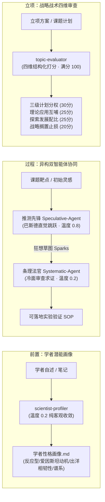

# Study-Harness：打造属于你自己的智能体 Harness

本仓库是微信公众号专栏**《打造属于你自己的智能体 Harness》**的官方配套开源代码库。由浅入深、循序渐进，带你从零手搓一套工业级的智能体基座。

---

## 目录索引与配套代码

* **第 01 讲**：大模型 API 底层通信与前缀缓存（Prompt Caching）极简原理
* **第 02 讲**：Think-Act-Observe 思考-行动-观察三元核心回路
* **第 03 讲**：[`chat_web/`](./chat_web) - 现代多轮对话交互控制台（FastAPI + Vue3 + SQLite 历史会话持久化）
* **第 04 讲**：国内外大语言模型选型与商业算账指南（海外主力包月订阅 vs 国产王牌 API 按量计费）
* **第 05 讲**：[`start_kitty.sh`](./start_kitty.sh)（服务端终端守护脚本）、[`connect.sh`](./connect.sh)（macOS 本地一键直连脚本）与 Web 控制台终端换芯
* **第 06 讲**：[`mcp_server.py`](./mcp_server.py)（方案 A: 标准 MCP 扩展）、[`scripts/harness_tools.py`](./scripts/harness_tools.py)（方案 B: CLI 独立脚本工具）、[`.agents/skills/study-harness-ops/`](./.agents/skills/study-harness-ops/)（方案 C: 本地专属 Skill）与 [`scripts/test_three_modes.sh`](./scripts/test_three_modes.sh)（三大模式一键测试）
* **第 07 讲**：科学家潜能诊断技能（[`system/skills/scientist-profiler/`](./system/skills/scientist-profiler/)）、异构双智能体协同与课题打分 MCP 服务（[`mcp_server.py`](./mcp_server.py) 工具：`collaborate_duo`、`evaluate_topic`）与自动化集成测试套件（[`tests/test_chapter_07.py`](./tests/test_chapter_07.py)）
* **第 08 讲**：想象力激发技能（[`system/skills/imagination-spark/`](./system/skills/imagination-spark/)）、死锁破局急救技能（[`system/skills/deadlock-breaker/`](./system/skills/deadlock-breaker/)）、闪念反刍与双智能体推演 MCP 服务（[`mcp_server.py`](./mcp_server.py) 工具：`ruminate_spark`、`dual_agent_reason`）与自动化集成测试套件（[`tests/test_chapter_08.py`](./tests/test_chapter_08.py)）
* **第 09 讲**：实验策划技能（[`system/skills/experiment-planner/`](./system/skills/experiment-planner/)）、达尔文打脸笔记技能（[`system/skills/darwin-critic-observer/`](./system/skills/darwin-critic-observer/)）、青霉素反常机遇洞察与张伯伦多假说打擂 MCP 服务（[`mcp_server.py`](./mcp_server.py) 工具：`detect_serendipity`、`chamberlin_hypotheses`）与自动化集成测试套件（[`tests/test_chapter_09.py`](./tests/test_chapter_09.py)）

---

## 第 05 讲实战：复用终端里的 AI CLI (`start_kitty.sh`)

各大顶尖厂商（如 Google、Anthropic）都在其官方终端 CLI 中内置了成熟的 Harness 工程能力（上下文自动压缩剪枝、精准 Diff 补丁、工具调用重试）。**复用终端里的成熟 AI，是普通人开发智能体最省钱、最强大的途径。**

### 1. 脚本原理与极简设计

文件 [`start_kitty.sh`](./start_kitty.sh) 全长仅 26 行，兼顾了极致精简与高安全容错：
1. **自动清理残留 Socket**：探测活跃实例防重复启动，清理异常断电死锁；
2. **IPC 控制门**：通过 Kitty `-o allow_remote_control=yes --listen-on=unix:...` 开放标准化遥控接口；
3. **会话持久化**：在 Kitty 内部运行 `tmux new-session -A -s workspace`，断网不断会话；
4. **无头服务器渲染**：在无显示器的 Linux 云端，自动调用 `xvfb-run` 创建虚拟帧缓冲（Framebuffer），完美解决 PTY 渲染问题。

#### 完整脚本源码 (`start_kitty.sh`)

```bash
#!/bin/bash
# ==============================================================================
# 极简版 Kitty + tmux 终端守护启动脚本 (专栏《打造属于你自己的智能体 Harness》第 4 讲配套)
# 作用：启动带 IPC 远程控制的 Kitty 终端，内置 tmux workspace 会话，实现终端 AI 的稳定复用
# 特性：支持 systemd 开机自启、实例防重检测、失效死 Socket 自愈清理、无头服务器虚拟渲染
# ==============================================================================
set -e

SOCK_PATH="${HOME}/.kitty.sock"
SOCK="unix:${SOCK_PATH}"
SESSION_NAME="${KITTY_TMUX_SESSION:-workspace}"

# 1. 活跃检测与防冲突：若已有活跃实例在运行，直接提示并安全退出
if [ -S "$SOCK_PATH" ] || [ -e "$SOCK_PATH" ]; then
    if kitten @ --to "$SOCK" ls >/dev/null 2>&1; then
        echo "✅ Kitty 实例已在后台运行中 (Socket: $SOCK_PATH)，无需重复启动。"
        echo "💡 直接执行接入：tmux attach -t $SESSION_NAME"
        exit 0
    fi
    # 若是宕机或异常断电留下的失效死 Socket，自动清理
    echo "⚠️ 检测到残留的失效 socket，正在清理: $SOCK_PATH"
    rm -f "$SOCK_PATH"
fi

echo "🚀 正在启动 Kitty 终端 (IPC: $SOCK, tmux: $SESSION_NAME)..."

# 2. 核心启动：无桌面 Linux 环境借助 xvfb-run 提供虚拟帧缓冲；本地桌面直接启动
if [ -z "$DISPLAY" ] && command -v xvfb-run >/dev/null 2>&1; then
    exec xvfb-run -a -s "-screen 0 1024x768x24" kitty -o allow_remote_control=yes --listen-on="$SOCK" tmux new-session -A -s "$SESSION_NAME"
else
    exec kitty -o allow_remote_control=yes --listen-on="$SOCK" tmux new-session -A -s "$SESSION_NAME"
fi
```

#### 让 AI 生成此脚本的提示语模板 (Prompt)

如果你想让本地 AI（如 Workbuddy、Cursor）自动生成此类脚本，直接发送以下提示语即可：

> **“请帮我写一个极简且安全的 Kitty 终端守护启动脚本 start_kitty.sh：**
> 1. 开启 Kitty 原生 IPC 远程控制监听（`unix:~/.kitty.sock`），并在终端内部默认启动并接入名为 `workspace` 的 tmux 会话；
> 2. 做好防重与自愈：启动前用 `kitten @` 探测该 socket，若已有活跃实例则直接提示退出，若为异常断电残留的死 socket 则自动清理；
> 3. 适配无桌面云服务器：若检测到无 `DISPLAY` 环境变量，自动通过 `xvfb-run` 创建虚拟屏幕渲染，桌面环境则直接启动；
> 4. 核心启动命令使用 `exec` 执行，便于后续 systemd 进程托管，全长控制在 30 行以内。”

### 2. 快速启动

在服务器或本地终端执行：

```bash
chmod +x ./start_kitty.sh
./start_kitty.sh
```

> **提示**：若在后台常驻运行，可使用 `nohup ./start_kitty.sh > /dev/null 2>&1 &`。

### 3. 连接终端并复用 AI CLI（以 Google Gemini 为例）

当后台 Kitty 终端启动后，直接通过 tmux 连接进入工作区：

```bash
tmux attach -t workspace
```

连接进入终端后，直接输入你已安装的 AI CLI 工具即可畅快使用：

* **复用 Google Gemini**：
  输入 `agy`，回车即可启动 Google 官方终端智能体（Antigravity CLI），直接调用背后的 Google Gemini 模型与全套系统级工具链；
* **复用 Claude**：
  输入 `claude`（Claude Code），直接利用已订阅的 Claude Pro 账号额度；
* **复用 DeepSeek / 开源模型**：
  输入 `aider`，直接挂载白菜价的高性价比 API。

离开终端时，按快捷键 `Ctrl + B`，再按 `D` 即可安全脱离（Detach）。服务器后台的 AI 任务不会中断，关机合盖也能全天候自动跑。

### 4. 外部程序远程操控终端 (IPC API)

你的 Web 后端（如 Python/Node.js）或自动化脚本无需 hack 进程，通过 Kitty 开放的 Unix Socket 即可直接遥控终端：

* **向终端发送指令（如启动 agy）**：
  ```bash
  kitten @ --to "unix:$HOME/.kitty.sock" send-text --match id:1 "agy\r"
  ```
* **读取终端屏幕输出**：
  ```bash
  kitten @ --to "unix:$HOME/.kitty.sock" get-text --match id:1
  ```

---

### 5. 生产环境开机自启与守护 (Systemd 部署)

在真实服务器生产环境中，该脚本正是通过 Linux 原生 `systemd` 实现了**开机自启动**与**宕机 3 秒自动拉起自愈**。

服务配置文件位于：`/etc/systemd/system/app-kitty-daemon.service`

```ini
[Unit]
Description=Kitty Terminal Remote Control Daemon
After=network.target

[Service]
Type=simple
User=ubuntu
WorkingDirectory=/home/ubuntu
Environment="PATH=/home/ubuntu/.local/bin:/usr/local/bin:/usr/bin:/bin"
ExecStart=/Users/jsmn/workspace/scripts/start_kitty.sh
Restart=always
RestartSec=3

[Install]
WantedBy=multi-user.target
```

#### 自启与运维管理命令

* **设为开机自启并启动**：
  ```bash
  sudo systemctl daemon-reload
  sudo systemctl enable --now app-kitty-daemon.service
  ```
* **查看运行状态**：
  ```bash
  systemctl status app-kitty-daemon.service
  ```
* **重启服务**：
  ```bash
  sudo systemctl restart app-kitty-daemon.service
  ```
* **查看运行日志**：
  ```bash
  journalctl -u app-kitty-daemon.service -f -n 50
  ```

有 `systemd` 在底层保驾护航，配合脚本内部的 Socket 活跃防重检测与失效自愈逻辑，无论服务器怎么重启，后台 AI 终端都能够全天候稳定在线。

---

## 客户端实战：macOS 本地一键直连与密钥免密登录

搞定了服务端的终端保活后，平时我们在个人电脑（如 macOS）上做开发时，怎样做到“一条指令瞬间直达云端 AI 终端”？

### 6. macOS 本地一键直连脚本 (`connect.sh`)

配套客户端脚本：[`connect.sh`](./connect.sh)

```bash
#!/bin/bash
# macOS 本地一键直连云端 AI 终端工作区脚本
SERVER_USER="${SERVER_USER:-ubuntu}"
SERVER_IP="${SERVER_IP:-你的服务器公网IP}"
PORT="${SERVER_PORT:-22}"

# -t 参数强制分配伪终端（PTY），远程直接接入 tmux 会话
exec ssh -t -p "$PORT" "${SERVER_USER}@${SERVER_IP}" "tmux attach -t workspace"
```

#### 使用方法：
1. 赋予执行权限：
   ```bash
   chmod +x ./connect.sh
   ```
2. 直接运行：
   ```bash
   ./connect.sh
   # 或者通过环境变量传入临时 IP：
   SERVER_IP=123.45.67.89 ./connect.sh
   ```
   只要云服务器已启动，敲完这一行直接无缝置身于云端 `tmux workspace` 终端中！直接敲 `agy` 即可唤起 Google Gemini，按 `Ctrl+B` 然后按 `D` 安全断开，本地电脑合盖也不会打断后台任务。

#### 进阶技巧：macOS 极简别名与 SSH Config 极速直达
如果你连 `./connect.sh` 都不想敲，有两种更极致的极简配置方式：

**方式 A：Shell 别名（Alias）**
在本地 `~/.zshrc`（或 `~/.bash_profile`）中加入一行：
```bash
alias ai="ssh -t ubuntu@你的服务器公网IP 'tmux attach -t workspace'"
```
执行 `source ~/.zshrc` 生效后，在 Mac 终端里直接敲一个单词 `ai` 并回车，瞬间直达云端！

**方式 B：SSH 配置文件（~/.ssh/config）**
在 macOS 本地的 `~/.ssh/config` 中追加：
```ssh-config
Host ai
    HostName 你的服务器公网IP
    User ubuntu
    Port 22
    IdentityFile ~/.ssh/id_ed25519
    RequestTTY yes
    RemoteCommand tmux attach -t workspace
```
这样只需执行：
```bash
ssh ai
```
系统会自动调用指定密钥、分配 PTY 并直达 tmux 会话。

---

### 7. 密钥自动免密登录的底层实现原理与配置

为了让一键直连完全不弹密码提示框，同时杜绝服务器被恶意爆破密码的风险，工业界一律采用 **SSH 非对称密钥认证机制**。

#### (1) 底层认证原理（为什么不用输密码，且比密码更安全？）
1. **公钥与私钥配对（非对称加密）**：
   * **私钥（Private Key，如 `id_ed25519`）**：存放在本地 macOS 个人电脑中，权限严格受限（`chmod 600`），**绝对不能泄露给任何人**；
   * **公钥（Public Key，如 `id_ed25519.pub`）**：存放在云端服务器的 `~/.ssh/authorized_keys` 中，相当于在服务器上挂了一把“公开的锁”。
2. **挑战/应答握手流程（Challenge-Response Authentication）**：
   * 当 Mac 发起连接请求时，服务器生成一串随机的字符串（“挑战包”），并用存储的公钥加密后发给 Mac；
   * Mac 本地拿到加密包后，用自己私藏的私钥进行解密，并将解密结果与数字签名发回服务器；
   * 服务器用公钥验证签名通过，瞬间放行登录！
   * **整个过程密码从不在网络中传输，黑客即便截获网络流量也无法推断出私钥**。

#### (2) 三步实操配置流程

**第 1 步：在 macOS 本地生成高强度密钥对**
推荐使用现代高性能的 Ed25519 算法（比传统 RSA 更快、更短、更安全）：
```bash
ssh-keygen -t ed25519 -C "macbook_ai_connect"
```
（一路回车即可，会在本地 `~/.ssh/` 下生成 `id_ed25519` 私钥和 `id_ed25519.pub` 公钥）

**第 2 步：将公钥一键上传到云服务器**
使用系统自带的 `ssh-copy-id` 命令：
```bash
ssh-copy-id -i ~/.ssh/id_ed25519.pub ubuntu@你的服务器公网IP
```
（输入最后一次服务器原本的账号密码，该命令会自动将公钥写入服务器端的 `~/.ssh/authorized_keys` 文件中）

**第 3 步：服务器端安全权限护栏校验**
SSH 协议对文件权限有着极度严格的铁律。如果权限设置过宽，SSH 服务端出于安全考虑会直接拒绝免密登录：
在云服务器端确保以下权限设置正确：
```bash
chmod 700 ~/.ssh
chmod 600 ~/.ssh/authorized_keys
```
在 macOS 本地端确保私钥权限安全：
```bash
chmod 600 ~/.ssh/id_ed25519
```

完成上述配置后，本地无论是执行 `./connect.sh`、`ssh ai` 还是 `ai` 别名，都不会再提示任何密码输入，毫秒级直接连入云端终端，即开即用！

#### (3) 借助 Workbuddy 等本地 AI 智能体一键完成（一句提示语）

如果你的 macOS 个人电脑中安装了类似 **Workbuddy**（或同类具备本地终端执行能力的现代 AI 智能体），你甚至连上面这一串命令都无需手动输入。

你只需要直接对 Workbuddy 说一句大白话提示语：

> **“帮我生成 ed25519 密钥，把公钥配置到远程服务器 123.45.67.89 实现免密登录，并在本地建一个连入 tmux workspace 的一键直连脚本。”**

Workbuddy 就会全自动在后台帮你生成本地密钥对、将公钥写入服务器端 `authorized_keys`、校验权限，并创建可执行的连接脚本。

#### (4) 核心架构哲学：必须先知道“服务器上的 SSH 是用完即销毁的”

尽管本地 AI 工具能够秒级执行上述指令，但**工具永远不会替你构思顶层设计**。要想完成上述这一整套工作流，**创作者必须首先具备这套架构认知，并且深刻理解“服务器上的 SSH 会话是用完就销毁的透明管道”这一核心道理：**

1. **新手的致命误区**：很多初学者以为 SSH 连接必须时刻保持、电脑不能合盖，误把任务直接挂在 SSH 窗口里。一旦遇到 WiFi 抖动或断网，终端掉线导致任务中止，就会陷入无尽的焦虑中；
2. **老手的架构真相**：
   * **SSH 是临时耗材**：SSH 连接不过是一根即插即用、用完即毁的透明传导电缆。敲一行连接，干完按 `Ctrl+B, D` 随时销毁断开，不浪费任何本地与网络资源；
   * **Kitty + tmux 是常驻母体**：真正承载业务执行状态与长久记忆的，是服务器端通过 `xvfb-run` + Kitty Socket + `tmux workspace` 焊死在 Linux 系统底层的常驻中枢。

**正因为你心里预先知道了这套“端云分离、SSH 即连即毁、tmux 常驻保活”的完整方案，你才能下出那句精准的 Workbuddy 提示语，把现代 AI 工具的效能发挥到极致。**

---

### 8. Web 控制台升级：核心循环全面接入终端 AI (agy CLI)

在之前的版本中，Web 框架的状态机循环（Think-Act-Observe）是通过 HTTP 请求直接调用 DeepSeek 接口实现的。

而在第 04 讲中，我们完成了核心循环的升级：**将原先向外部 HTTP API 接口发送请求，全面改造为向本地终端 AI CLI（Google Gemini 驱动的 `agy`）发送请求**。

#### (1) 改造核心点 (`chat_web/backend/main.py`)
1. **指令派发与流控**：
   通过 Python 的 `subprocess.run`，以命令行参数及结构化 JSON 格式直接与 `agy` CLI 交互：
   ```bash
   agy -p "用户输入内容" --output-format json --dangerously-skip-permissions [--conversation <conv_id>]
   ```
2. **多轮对话状态持久化**：
   在 SQLite 数据库的 `sessions` 表中新增 `conversation_id` 字段。每次从终端 AI 返回持久化会话 ID 后自动绑定，实现 Web 页面上的多轮对话与终端 CLI 的上下文无缝同步；
3. **推演与思考日志呈现**：
   将终端 CLI 返回的真实思考推演（`thinking_tokens`）、耗时及 Token 消耗完整格式化为推演日志，直观呈现在 Web 前端的灰色折叠卡片中；
4. **双轨平滑降级（无缝兼容）**：
   自动探测本地终端是否具备 `agy` 命令。若检测到则优先走极速免费的终端 AI 线路；若未检测到终端环境，自动无感降级为原有的 DeepSeek HTTP API 循环，确保读者无论在什么环境下都能开箱即用。

#### (2) 本地与服务器一键运行验证

修改后的代码全面支持在本地个人机器或云端服务器上一键拉起。Web 界面与后端服务统一由 FastAPI 托管，默认监听端口为 `3010`。进入目录执行：

```bash
cd chat_web
python3 backend/main.py
```

启动完成后：
* **本地测试**：直接用浏览器打开 `http://127.0.0.1:3010`；
* **远程服务器测试**：通过手机或电脑浏览器访问 `http://服务器公网IP:3010`（或配置 SSH 端口转发 `ssh -L 3010:127.0.0.1:3010 user@ip`）。

#### (3) 实测提示语与比对

进入 Web 控制台后，在下方输入框发送极简测试词：
> `请回复：你是谁？要求极简，十字以内。`

* **正式答复**：页面迅速呈现极简答复（例如：`我是谷歌 AI 助手。`，具体取决于本地配置的 CLI 模型）；
* **折叠推演卡片**：点击消息上方的灰色卡片展开，即可完整查看由后台 `agy -p` 子进程执行的 Think-Act-Observe 决策全景、耗时与 Token 明细，零 API 费用消耗！

#### (4) 架构探秘：为什么共享终端屏幕上看不到打字？（多指令并行与人机解耦）

很多读者实测时会产生疑问：*我明明连着云端终端，为什么在网页上跟 AI 聊天时，终端屏幕上没有打字记录？*

这恰恰是工业级智能体架构最关键的分水岭：
* **若采用“屏幕打字注入”（`tmux send-keys`）**：相当于多个用户同时抢一个键盘和一个光标。若两人同时提问，或者你正用 SSH 敲命令，按键会在屏幕上瞬间拼成乱码，且并发度被锁死在 1（必须排队死等上一个人打完字）；
* **当前采用的“独立子进程架构”（`subprocess.run`）**：每一条 Web 指令都在后台唤醒一个独立的 `agy` 无头算力进程。不仅**多会话在多核 CPU 上完全并行推进**，而且**你在 SSH 终端里改代码、敲命令完全不受哪怕一个光标的打扰**，实现了彻底的人机解耦与记忆隔离。

#### (5) 跨 CLI 迁移：换成 Claude Code 或 Aider 需要改代码吗？

* **代码里的 `-p` 代表什么？**
  `-p` 即 `--print`（非交互打印模式）。不弹全屏 TUI 界面，直接接收提示词在后台完成全部推演与工具调用，把纯净结果（或结构化 JSON）吐给标准输出并退出，将终端 AI 转化为高并发无状态的“计算微服务”。
* **需要改动前端或数据库吗？**
  **完全不需要！** 前端 Vue3、FastAPI 路由、SQLite 数据表和多轮上下文持久化结构 100% 通用。
* **各主流终端 AI 的适配参数对照**：
  * **Google Gemini (`agy`)**：`agy -p "提示语" --output-format json [--conversation <id>]`
  * **Anthropic Claude Code (`claude`)**：`claude -p "提示语" --output-format json [--resume <id>]`
  * **Aider (`aider`)**：`aider --message "提示语" --yes`
  本套 Harness 架构天生具备**模型中立性**，只需调整底层的一两行命令行参数映射，即可把全世界各大厂商的顶级终端 AI 自由插拔、无缝复用！

---

### 9. 第 06 讲实战：三种方式扩展 AI CLI 的私有业务能力（MCP 协议、独立脚本与本地 Skill）

#### (1) 为什么原来代码里的 `TOOL_MAP` 没被触发？

在第 02/03 讲手搓核心循环时，我们通过字典形式定义了本地工具：
```python
TOOL_MAP = {
    "read_file": read_file,
    "write_file": write_file
}
```
当大模型（如 DeepSeek HTTP 接口）返回带有 `tool_calls` 的 JSON 时，我们的 Python 宿主循环拦截该请求并执行本地函数。

而到了第 05/06 讲，当我们把核心循环换成调用终端 AI（`agy -p` 或 `claude -p`）时：
* **裸 API（如 DeepSeek/OpenAI HTTP）**：相当于“有大脑没手脚”。模型本身只返回一段文本/JSON 表示“我想调用某个函数”，手脚完全靠我们手搓的 Python 宿主循环驱动；
* **终端 AI（如 agy / Claude Code）**：相当于“全副武装的特种兵”，它们本身就是一套完整的智能体 Harness。官方在内部打磨了极其严密的系统级工具链（文件读写、Bash 执行、Git 差异比对、全库搜索）。通过 `agy -p` 调用时，它在独立的进程沙箱中运行原生系统工具，自然不再经过 Python 宿主中的内存字典。

#### (2) 项目扩展架构体系：`system/` 目录组织

为了让业务扩展结构清晰、职责分离，本项目在根目录下统一建立 `system/` 目录，分为三大子模块：
* **`system/mcp/`**：存放符合 MCP (Model Context Protocol) 标准规范的独立微服务；
* **`system/scripts/`**：存放高内聚、零依赖的 Python 命令行脚本工具；
* **`system/skills/`**：存放遵循 Agent Skills 规范的专属业务技能与 SOP。

#### (3) 三大主流工程扩展方案实战与测试提示语设计

##### 方案 A：自建天气 MCP (Model Context Protocol) 微服务
* **源码实现**：[`system/mcp/weather_mcp.py`](./system/mcp/weather_mcp.py)
* **核心原理**：数据源直连 `wttr.in` 开放天气服务（如 `curl "wttr.in/Shanghai?1"` 或 JSON 接口 `wttr.in/Shanghai?format=j1`），零 API Key 依赖。将其封装为标准 MCP 工具服务：`get_weather` 与 `compare_weather`。
* **在 Web 程序中注册与调用**：
  * **自动注册**：[`chat_web/backend/main.py`](./chat_web/backend/main.py) 在启动时自动检测并调用 `agy mcp add weather-service python3 system/mcp/weather_mcp.py` 挂载到终端 AI；同时在后端备用引擎的 `TOOL_MAP` 中内置支持，确保双轨平滑运行。
* **专属测试提示语 1**：
  > “请查询明天北京和上海的温度哪个高，高多少啊”
* **终端 AI 真实调用输出**：
  > 明天（2026年11月3日）**上海**的气温更高。
  > 
  > 具体对比情况如下：
  > - **北京**：最高 17°C，最低 7°C，平均 13°C（晴朗）
  > - **上海**：最高 20°C，最低 14°C，平均 17°C（多云）
  > 
  > **温差情况**：
  > - **最高气温**：上海比北京高 **3°C**（20°C vs 17°C）
  > - **最低气温**：上海比北京高 **7°C**（14°C vs 7°C）
  > - **平均气温**：上海比北京高 **4°C**（17°C vs 13°C）

##### 方案 B：独立命令行工具脚本 (纯净 Markdown 字符统计)
* **源码实现**：[`system/scripts/count_markdown_chars.py`](./system/scripts/count_markdown_chars.py)
* **核心功能**：统计 Markdown 文件的非空白字符总数。严格跳过开头的 YAML Frontmatter、排除所有的 `>` 引用块、排除所有的 ```` 代码块，仅统计正文阅读文字。
* **调用机制的深度思考：AI 如何自主发现并调用？**
  * 传统做法要求用户在提示词里死板写出 `python3 system/scripts/xxx.py`，本质上人类仍在扮演调度员；
  * 本项目采用**声明式工具清单（Declarative Agent Manifest）**：在根目录下提供 [`AGENTS.md`](./AGENTS.md) / `GEMINI.md`，向终端 AI 声明 `system/scripts/` 下各脚本的职能与调用时机。终端 AI 启动时自动建档，根据自然语言意图自主定位脚本并调用 Bash 工具执行！
* **专属测试提示语 2**（仅给目标文件路径，不提脚本名）：
  > “请统计文件 /Users/jsmn/workspace/column-harness/正文/10-30-6.md 里有多少非空白字符”
* **终端 AI 真实调用输出**：
  > 已使用系统专有脚本完成统计，`10-30-6.md` 的纯净正文字符统计结果如下：
  > - **非空白字符总数**：**3,874** 字
  > - **有效正文行数**：48 行
  > - **排除引用行**：3 行（已自动过滤 > 引用块）
  > - **排除代码块行**：0 行
  > - **原始总行数**：105 行

##### 方案 C：本地专属技能 (五言绝句创作与起句雅化)
* **源码实现**：[`system/skills/quatrain-poet/SKILL.md`](./system/skills/quatrain-poet/SKILL.md)
* **核心功能**：
  * 接收用户提供的一句开篇短语（哪怕带有口语或字数不规范，如 6 字的“河面清如镜啊”）；
  * 自动剥离口语助词，提炼为五言正格起句“河面清如镜”；
  * 依据古典诗词意境自动拟定典雅诗名（如《镜波晚照》）；
  * 严格遵循平水韵/中华新韵二四句押平声、第三句仄收的格律创作五言绝句，附带结构赏析。
* **专属测试提示语 3**：
  > “以“河面清如镜啊”作为第一句 写一个五言绝句”
* **终端 AI 真实调用输出**：
  > ### 《镜波晚照》
  > 
  > 河面清如镜，  
  > 云峰倒影浮。  
  > 忽惊游鹭起，  
  > 揉碎满江流。  
  > 
  > ---
  > - **体裁**：五言绝句（依平水韵·下平十一尤韵）
  > - **题解与立意**：
  >   - **首句雅化**：用户原提示短句“河面清如镜啊”包含口语语气助词“啊”，计六字。依据格律法度剥除语气赘字，提炼出典雅端谨的五言起句“河面清如镜”。
  >   - **起承转合**：起句水镜澄澈；承句云山倒映（浮字押平韵）；转句水禽惊飞（起字仄收破静为动）；合句波光荡漾（流字押平韵），意境深远。

#### (4) 一键自动化测试脚本 (`test_three_modes.sh`)

为了方便读者快速检验三种方式在本地或云服务器上的运行效果，项目提供了配套的统一测试脚本：[`scripts/test_three_modes.sh`](./scripts/test_three_modes.sh)。

赋予权限并一键运行：
```bash
chmod +x scripts/test_three_modes.sh
./scripts/test_three_modes.sh
```
该脚本将依次自动化触发：
1. `agy -p` 调用自建天气 MCP 协议函数并对比京沪明日气温；
2. `agy -p` 自主识别并调度本地 Python 脚本完成 Markdown 纯净字符统计；
3. `agy -p` 通过自然语言触发本地专属五言绝句 Skill 完成古典诗词创作。

#### (5) 三大方案的工程选型全景对比

| 维度 | 方案 A：天气 MCP 协议 (`weather_mcp.py`) | 方案 B：独立 CLI 脚本 (`count_markdown_chars.py`) | 方案 C：本地专属 Skill (`quatrain-poet`) |
| :--- | :--- | :--- | :--- |
| **底层载体** | 标准 JSON-RPC (stdio 管道) | 操作系统原生 Bash / 命令行 | Markdown SOP 规范 + 渐进式披露 |
| **触发方式** | 模型工具调度 / Web 启动自动注册 | **声明式清单自主识别**（无需在提示词写脚本名） | **纯自然语言意图模糊匹配** |
| **跨工具通用性** | 需宿主 AI 支持 MCP (agy, Claude Code, Cursor) | 通用于所有具备 Bash 能力的 Agent | 通用于所有兼容 Agent Skills 规范的智能体 |
| **部署与运维成本** | 需安装 `mcp` 依赖库并通过命令注册配置 | **零额外依赖**，纯 Python 标准库，即拷即用 | **零配置**，Git 提交即分发，开箱即生效 |
| **上下文占用** | 启动时注入全部工具 JSON Schema | 仅在被调用时输出结果占用上下文 | **渐进式披露**：平时仅占几十字符描述，命中后才展开 |
| **最适场景** | 跨系统服务调用、实时外部接口与结构化契约 | 确定性数据统计、本地文件批量清洗、零依赖小工具 | **具有特定行业法度、多步骤 SOP、专业意境与心智要求的任务** |
| **跨工具通用性** | 需宿主 AI 支持 MCP (agy, Claude Code, Cursor) | 通用于所有具备 Bash 能力的 Agent | 通用于所有兼容 Agent Skills 规范的智能体 |
| **部署与运维成本** | 需安装 `mcp` 依赖库并通过命令注册配置 | **零额外依赖**，纯 Python 标准库，即拷即用 | **零配置**，Git 提交即分发，开箱即生效 |
| **上下文占用** | 启动时注入全部工具 JSON Schema | 仅在被调用时输出结果占用上下文 | **渐进式披露**：平时仅占几十字符描述，命中后才展开 |
| **最适场景** | 复杂结构化对象交互、跨跨机器微服务 | 确定性运维、离线批处理、零依赖小工具 | **面向用户的多步骤业务排查、全景诊断体检与自动化 SOP** |


---

## 第 07 讲实战：科学家性格画像、异构双智能体协同与课题战略审查

本讲配套专栏文章**《07 为什么考霸搞不出大发明？《科学研究的艺术》之科学家与战略》**。
基于剑桥大学老教授 W.I.B. 贝弗里奇的经典名著《科学研究的艺术》第十一章「科学家」与第十章「战略和战术」，我们为研创学者手搓了三套兼具深厚理论底蕴与硬核工程落地的研创武器。



### 1. 三大核心能力与设计哲学

#### (1) 科学家潜能诊断技能 (SKILL: `scientist-profiler`)
- **定位**：原生 Agent 技能（[`system/skills/scientist-profiler/`](./system/skills/scientist-profiler/)）。
- **理论依据**：贝弗里奇指出，世界上几乎没有十全十美的科学家；开拓者往往在常人眼里脾气叛逆古怪，而应试考试偏袒的往往是规规矩矩的“被动型知识仓库”（如埃利希考不过药理剂量却砸出神药六零六）。
- **四维诊断**：
  1. **反应型 vs 被动型**：是否具备敢于怀疑既成教条的开拓者原生土壤；
  2. **爱因斯坦科研三分法**：竞技场运动员 vs 职业谋生者 vs 真正献身者；
  3. **出洋相心理韧性**：弗莱克斯纳之问（“你准备好在所里当众出洋相了吗？”）与巴斯德式的顽强坚持力；
  4. **认知谱系**：推测型（浪漫派） vs 条理型（古典派）比例分布。
- **执行温度**：`0.2`（冷酷严谨、拒绝廉价客套与阿谀奉承）。
- **产出文件**：默认归档至 `认知/学者性格画像.md`。

#### (2) 异构双智能体协同推演服务 (MCP 工具: `collaborate_duo`)
- **定位**：标准 MCP 服务协议跨进程工具（挂载于 [`mcp_server.py`](./mcp_server.py)）。
- **理论依据**：原书第十一章推测型与条理型黄金协同机制（泰勒博士大型研究机构法）。
- **核心机制**：
  - **推测先锋（Speculative-Agent · 温度 0.8）**：凭敏锐直觉跳跃前行，跨越事实提出 2~3 个最具颠覆性的假说雏形；
  - **条理法官（Systematic-Agent · 温度 0.2）**：冷酷接管案卷，排查逻辑漏洞，挑选核心火种，设计具备单一变量与严密基线对照的工程化验证方案，并焊死不可逾越的止损铁轨（防止浪漫派留下烂尾楼）。

#### (3) 课题打分服务 (MCP 工具: `evaluate_topic`)
- **定位**：标准 MCP 服务协议跨进程工具（挂载于 [`mcp_server.py`](./mcp_server.py)）。
- **理论依据**：原书第十章《战略和战术》中实用（组织/计划）与理想（自由/纯理论）的辩证平衡。
- **四维评分模型 (满分 100 分)**：
  1. **三级计划分权合理性 (30分)**：宏观定靶心筹粮饷、中观定主攻山头、微观战术 100% 交由一线自由发挥（严禁后方行政瞎指挥）；
  2. **理论与应用深度互哺度 (25分)**：杜绝狭隘实用主义，深入穿透底层微观机理，以理论反哺应用；
  3. **探索性与发展性风险配比 (25分)**：冒险开拓新大陆与稳妥修筑堤坝的接力机制；
  4. **战略性搁置与止损机制 (20分)**：死锁时的“拔电源”潜意识孵化气口与务实放弃底线。
- **执行温度**：`0.2`。
- **产出文件**：默认归档至 `认知/课题战略审查报告.md`。

---

### 2. 调用方式与实操指南

#### 方式一：Agent Skill 原生意图触发与执行 (`system/skills/`)
科学家潜能诊断作为专属技能，智能体可根据自然语言意图无感自动调用：
- `system/skills/scientist-profiler/`（[SKILL.md](./system/skills/scientist-profiler/SKILL.md)）

**底层驱动模块直接执行**：
```bash
python3 system/skills/scientist-profiler/scripts/profiler.py --name "张学者" --text "工作习惯自述..." --output "认知/学者性格画像.md"
```

#### 方式二：标准 MCP 服务协议跨进程调用 (`mcp_server.py`)
在任何支持 MCP 的宿主 AI（如 Antigravity CLI、Claude Code 等）中，已通过 `mcp_server.py` 挂载原生服务工具：
- `collaborate_duo(topic_or_spark, max_rounds, output_file)`
- `evaluate_topic(topic_description, topic_title, output_file)`

**MCP 工具调用参数示例**：
```json
{
  "topic_or_spark": "如何利用大模型自动发现中医药经典配伍反常规律？",
  "max_rounds": 1,
  "output_file": "认知/双智能体推演报告.md"
}
```

#### 方式三：自然语言实测用例（直接在宿主 AI 对话框中测试）
- **用例 1（测试 `scientist-profiler` 技能）**：
  > “请帮我做一次学者性格画像与潜能诊断。我的情况是：大学时数学成绩很好，但我总爱琢磨冷门交叉学科，常被老师批评不务正业。参加工作后，我特别受不了领导天天盯日报周报和进度表，很多好思路都是晚上散步时突然蹦出来的。但我最大的弱点是容易喜新厌旧，同时开好几个课题，核心难点摸通后就觉得繁琐枯燥，很难全部收尾；心里想做点颠覆性的东西，又有点怕同行嘲笑我想法幼稚。请客观给我做一次体检，并告诉我怎么搭配数字外骨骼。”
- **用例 2（测试 `collaborate_duo` MCP 服务）**：
  > “我想开辟一个新方向：‘能否利用大语言模型自动比对古今中医药典籍与现代分子生物学数据库，跨时空挖掘出反常的经典配伍规律，并预测未知药物协同机制？’请启动推测与条理异构双智能体协同推演器，让推测先锋先提假说，再让条理法官进行工程化排雷与落地设计。”
- **用例 3（测试 `evaluate_topic` MCP 服务）**：
  > “请对我们团队拟申报的课题《超导量子芯片常温探针研发》进行战略审查与四维打分。方案如下：我们由三名博士组成攻坚团队，组员完全自主安排每日实验与技术细节，但需每周汇报里程碑；先攻克探针底层微观机理，再做实际检测应用；设定了严格止损——如果连续三个月无法观测到有效共振信号，课题立即冻结并转向备用方案。请给出百分制评分、各维度扣分原因与修改建议。”

---

### 3. 一键自动化集成测试套件

执行配套自动化集成测试套件，全面核验底层通信与三大引擎：
```bash
python3 tests/test_chapter_07.py
```

**测试通过实测输出**：
```text
[+] 正在启动第 07 讲集成测试，API Key: sk-6d3...
  [✓] DeepSeek 通信正常
  [✓] 科学家性格画像引擎测试通过
  [✓] 异构双智能体协同推演器测试通过
  [✓] 课题战略审查与四维打分引擎测试通过
  [✓] MCP Server 5 大工具挂载完整性测试通过

----------------------------------------------------------------------
Ran 5 tests in 53.933s

OK
```

---

## 第 08 讲实战：大脑机制外骨骼化（想象力、直觉反刍、推理与死锁破局）

专栏第 08 讲深度解析《科学研究的艺术》第五、六、七、九章，揭示人脑“加压-泄压-潜意识孵化”的自然节律，交付 4 项实战能力（严格区分 2 项原生 Agent 技能与 2 项跨进程 MCP 服务）：

### 1. 四大核心能力设计

#### (1) 想象力激发技能 (SKILL: `imagination-spark`)
- **定位**：原生 Agent 技能（[`system/skills/imagination-spark/`](./system/skills/imagination-spark/)）。
- **理论依据**：第五章《想象力》之提问的艺术。运行 Why（目的性与跨界反问，温度 0.8）与 How（微观机理与物理齿轮咬合）双螺旋提问手艺，在好奇与松弛中心智自然生发突破火花。
- **底层执行**：`python3 system/skills/imagination-spark/scripts/spark.py`

#### (2) 反刍随身记与闪念捕获服务 (MCP 工具: `ruminate_spark` / `get_daily_rumination`)
- **定位**：标准 MCP 服务工具（挂载于 [`mcp_server.py`](./mcp_server.py)）。
- **理论依据**：第六章《直觉》之加压-泄压与随身纸笔。将突发顿悟秒记存入 `反刍/YYYY-MM-DD.md`，实现工作记忆即刻卸载（Unload），清空大脑缓存，静待潜意识拼图。

#### (3) 侦探与法官双智能体推演服务 (MCP 工具: `dual_agent_reason`)
- **定位**：标准 MCP 服务工具（挂载于 [`mcp_server.py`](./mcp_server.py)）。
- **理论依据**：第七章《推理》之侦探与法官职能分离。敏锐侦探（温度 0.8）凭直觉大胆追踪模糊线索设想因果分支；冷面法官（温度 0.2）冷酷排伪并输出法律判决般严密的闭环裁决。

#### (4) 死锁破局急救技能 (SKILL: `deadlock-breaker`)
- **定位**：原生 Agent 技能（[`system/skills/deadlock-breaker/`](./system/skills/deadlock-breaker/)）。
- **理论依据**：第九章《困难》之思维定势与破局三味药（执行温度 0.3）。一键开出拔电源（强制战略搁置冷冻）、拆大山（解构成软柿子切片）与胡同大爷会诊（常识大白话愣头青发问）三味猛药。
- **底层执行**：`python3 system/skills/deadlock-breaker/scripts/breaker.py`

---

### 2. 一键自动化集成测试套件

执行配套自动化集成测试套件，全面核验第 08 讲四大能力：
```bash
python3 tests/test_chapter_08.py
```

**实测输出**：
```text
[+] 正在启动第 08 讲集成测试，API Key: sk-6d3...
  [✓] 想象力激发技能 (SKILL imagination-spark) 测试通过
  [✓] 反刍随身记与闪念捕获 MCP 服务 (intuition-ruminator) 测试通过
  [✓] 侦探与法官双智能体推演 MCP 服务 (dual-agent-reasoning) 测试通过
  [✓] 死锁破局急救技能 (SKILL deadlock-breaker) 测试通过
  [✓] MCP Server 第 08 讲工具挂载完整性测试通过

----------------------------------------------------------------------
Ran 5 tests in 41.873s

OK
```

---

## 第 09 讲实战：实证检验外骨骼化（实验策划、反常机遇、多假说打擂与达尔文打脸笔记）

专栏第 09 讲《捡回被扔掉的青霉素》聚焦科研实证检验与反常机遇的转化心法，深度融合贝弗里奇《科学研究的艺术》第二章（实验）、第三章（机遇）、第四章（假说）与第八章（观察），交付 4 项实战能力（严格区分 2 项原生 Agent 技能与 2 项跨进程 MCP 服务）：

### 1. 四大核心能力设计

#### (1) 实验策划技能 (SKILL: `experiment-planner`)
- **定位**：原生 Agent 技能（[`system/skills/experiment-planner/`](./system/skills/experiment-planner/)）。
- **理论依据**：第二章《实验》之渐进三步法策划与对照防骗铁律。强制推行 Pilot 极小试点探路、大稀释度摸底观测与大范围精准海选三阶推进，设立严密阴性/阳性基线对照，坚决杜绝约翰·亨特式无对照自欺（执行温度 0.2）。
- **底层执行**：`python3 system/skills/experiment-planner/scripts/planner.py`

#### (2) 青霉素反常机遇洞察服务 (MCP 工具: `detect_serendipity`)
- **定位**：标准 MCP 服务工具（挂载于 [`mcp_server.py`](./mcp_server.py)）。
- **理论依据**：第三章《机遇》之巴斯德定律与反常机遇深挖。严禁将实验报错、意外污染或离群反常数据当垃圾倒掉，逆向审计其对既定偏见的破产冲击，提炼青霉素级的突破假说并给出低成本顺藤摸瓜追踪指南（执行温度 0.6）。

#### (3) 张伯伦多假说打擂服务 (MCP 工具: `chamberlin_hypotheses`)
- **定位**：标准 MCP 服务工具（挂载于 [`mcp_server.py`](./mcp_server.py)）。
- **理论依据**：第四章《假说》之张伯伦多工作假说原则。彻底粉碎“单一假说视若己出”的认知牢笼，针对难题并发提出 3~4 个互不兼容、切入角度完全不同的假说，并设计排他性判决实验（Crucial Test）让其同台打擂比拼（执行温度 0.7）。

#### (4) 达尔文打脸笔记技能 (SKILL: `darwin-critic-observer`)
- **定位**：原生 Agent 技能（[`system/skills/darwin-critic-observer/`](./system/skills/darwin-critic-observer/)）。
- **理论依据**：第八章《观察》与第四章《假说》之达尔文黄金法则（3 分钟打脸抢救机制）与客观事实/主观脑补隔离。以极端冷峻的挑剔法官姿态直击心爱假说的死穴与阿喀琉斯之踵，极限测定盲区并出具纯客观再观察清单（执行温度 0.2）。
- **底层执行**：`python3 system/skills/darwin-critic-observer/scripts/darwin.py`

---

### 2. 一键自动化集成测试套件

执行配套自动化集成测试套件，全面核验第 09 讲四大能力：
```bash
python3 tests/test_chapter_09.py
```

**实测输出**：
```text
[+] 正在启动第 09 讲集成测试，API Key: sk-6d3...
  [✓] 实验策划技能 (SKILL experiment-planner) 测试通过
  [✓] 青霉素反常机遇洞察 MCP 服务 (serendipity-radar) 测试通过
  [✓] 张伯伦多假说打擂 MCP 服务 (chamberlin-hypotheses) 测试通过
  [✓] 达尔文打脸笔记技能 (SKILL darwin-critic-observer) 测试通过
  [✓] MCP Server 工具挂载完整性测试通过

----------------------------------------------------------------------
Ran 5 tests in 48.301s

OK
```
