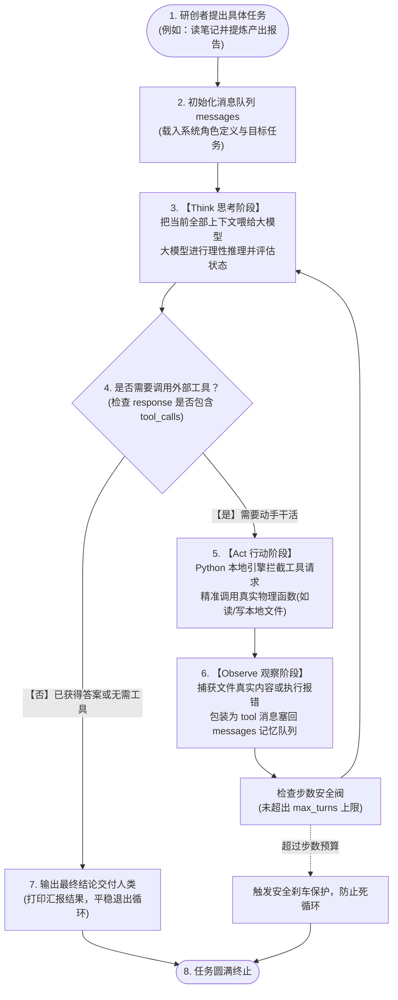

# Study-Harness

融汇贝弗里奇科研艺术与实践论，用 AI 为科研学者和创作者打造的数字研创系统（Harness）。

本项目是专栏**《跟我手搓学者研创系统：Study-Harness》**的官方配套开源代码库。每一个阶段的实现均配备完整测试与实操示例，方便读者对照阅读、复现并查看历史演进提交（Commit）。

---

## 阶段演进：第 02 篇 · Think-Act-Observe 三级循环核心

在**第 02 篇《给脑子安上手脚：手搓 Harness 的三级循环核心（Think-Act-Observe）》**中，我们从最简易的单次问答调用出发，通过普林斯顿与谷歌大脑的 **ReAct**（ICLR 2023）理论体系，亲手搓出了一套带有真实本地工具调用能力的自闭环引擎。

### 核心流转架构



---

## 项目目录结构

```text
study-harness/
├── study_harness/             # 核心 Python 包
│   ├── __init__.py           # 模块暴露导出
│   ├── client.py             # DeepSeek/OpenAI 客户端工厂
│   ├── tools.py              # 本地工具实现 (read_file / write_file / Schema)
│   └── engine.py             # Think-Act-Observe 状态机核心主循环
├── examples/                  # 教学演示示例（与专栏篇章完全对齐）
│   ├── 01_basic_deepseek.py  # 基础单次问答演示（缸中之脑无状态阶段）
│   └── 02_think_act_observe_loop.py # 完整三级循环手搓闭环演示
├── tests/                     # 自动化测试套件
│   ├── test_tools.py         # 读写工具单元测试
│   ├── test_engine_mock.py   # 状态机 Mock 收敛与熔断测试（无外部依赖）
│   └── test_live_deepseek.py # 真实 API 在线联调端到端测试
├── main.py                    # 统一命令行运行入口
├── requirements.txt           # 依赖清单
├── .env.example               # 环境变量配置模板
└── README.md
```

---

## 快速上手

### 1. 配置环境

```bash
# 安装依赖
pip install -r requirements.txt

# 配置 API Key
cp .env.example .env
# 编辑 .env 文件，填入你的 DeepSeek API Key
# DEEPSEEK_API_KEY="sk-..."
```

### 2. 运行专栏示例

#### 示例 1：基础问答调用（第 1 节代码）
```bash
python examples/01_basic_deepseek.py
```

#### 示例 2：Think-Act-Observe 状态机自闭环（第 3 节代码）
```bash
python examples/02_think_act_observe_loop.py
```

#### 命令行执行任意研创任务
```bash
python main.py "请读取本地的原始笔记.txt，提炼三个论点并写入提炼报告.txt"
```

---

## 运行自动化测试

我们坚决践行“每前进一步都要有确定性测试保障”的工程原则：

```bash
# 运行全部测试（包含单元测试、状态机流转测试及在线联调）
pytest -v
```

测试覆盖重点：
1. **工具确定性**：验证 `read_file` 与 `write_file` 的路径安全、非空写入与缺省报错；
2. **状态机自收敛（Mock 测试）**：验证模型在 3 轮交互内顺利完成“Think ➔ Act ➔ Observe ➔ Think ➔ Act ➔ Observe ➔ Finish”全闭环；
3. **安全熔断防线**：验证当外部模型陷入死循环时，`max_turns` 安全刹车能够强制熔断并保护程序。
